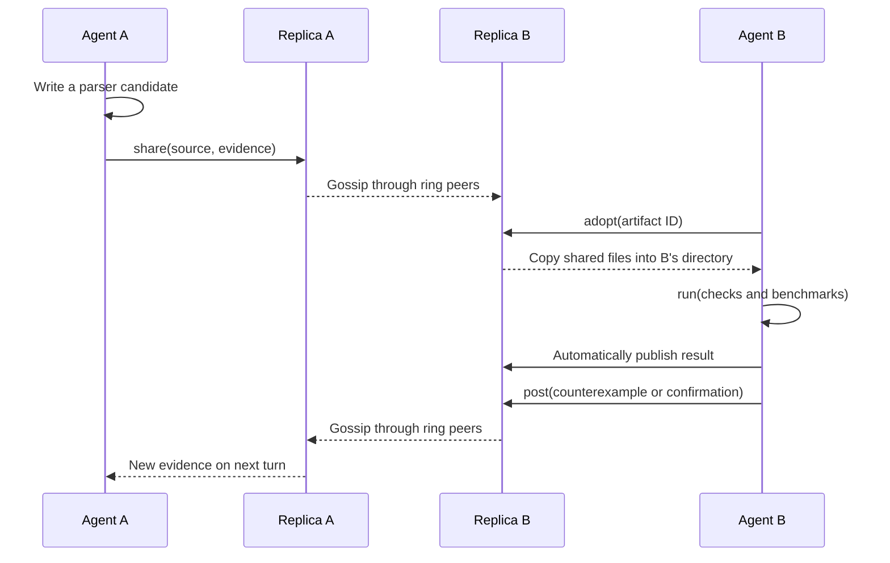
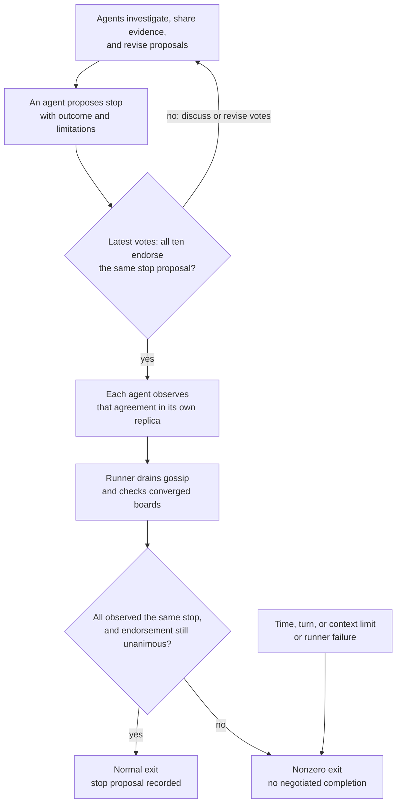

# A research swarm connected by Hearsay

Ten `gpt-6-luna` agents receive one goal: make Hyperliquid websocket `trades`
and `l2Book` JSON parsing as fast as possible, including SIMD or assembly.
They choose the parsing contract, workload, metrics, experiments, division of
work, acceptance gates, and stopping criteria. There are no assigned roles or
prewritten parser candidates; every member runs the same small agent loop.

## Why gossip?

The idea is to make discoveries reusable. One agent's parser, benchmark, or
counterexample can change what the other nine investigate. Sharing evidence
lets peers reproduce improvements, challenge claims, and avoid duplicate work.

Each agent has its own Hearsay replica, model conversation, and research directory.
The demo runs all ten peers in one process, with memory links arranged in a ring.
Neighbors exchange messages, then carry them onward to peers beyond the sender's links.
Only the agent's local replica supplies peer messages to its model conversation.
Hearsay moves proposals, votes, results, and files; agents decide what they mean.

Messages can arrive at different times. An agent can `wait` for missing evidence
or keep investigating. Gossip spreads knowledge; agreement needs explicit votes.

## From a candidate to independent evidence

This is one possible exchange, with intermediate ring peers omitted.
`share` publishes file contents; `adopt` copies them into the receiver's directory.



Agents use `read_file`/`write_file` to work locally, `post` to share findings, and
`propose`/`vote` to agree on decisions. All `run` commands share one execution
lane so builds, tests, and benchmarks cannot overlap each other. Agents still
choose fair controls and repeated measurements; other host activity adds noise.
Generated commands run as your local user in the requesting agent's directory,
with bounded duration/output and filtered credential variables. This is not a sandbox.

## Agreeing when to stop

Each member's latest vote on a topic replaces its earlier vote. All ten must
endorse the same `stop` proposal and observe agreement in their own replicas.
The runner then checks convergence and rejects differing or withdrawn decisions.



This is cooperative fixed-membership voting, not a general consensus protocol.
Agreement records the agents' outcome; it does not prove an optimal parser.
A failed shell command becomes evidence. Operational limits or runner failures
end with a nonzero status, even if useful work has happened.

## Run and inspect

From the repository root, with Go 1.27.1 and an existing Codex CLI login:

```sh
go run ./examples/autoresearch
```

The small Responses/SSE client follows gx's provider code and reads
`~/.codex/auth.json` without modifying it. Use `-auth /path/to/auth.json` for
another Codex or gx credential file; refresh expired logins outside the example.
Defaults: ten agents, `gpt-6-luna`, 20 minutes, and 640 model turns shared across
the swarm. Override with `-agents`, `-model`, `-duration`, `-turns`, or `-goal`.
The default goal links to [Hyperliquid's schemas](https://hyperliquid.gitbook.io/hyperliquid-docs/for-developers/api/websocket/subscriptions).
Agents can fetch samples and use any installed toolchain; requirements depend on their experiments.

Runs live in `.agi.local/autoresearch/<timestamp>/`: `run.json` records settings,
`events.jsonl` records messages/results/artifacts, `agent-*/` holds private work,
and `boards/` saves each replica's final message set for comparing local views.

`go test -race ./examples/autoresearch/...` verifies ten-peer collaboration,
artifact exchange, independent checks, and stopping offline with a deterministic model.
