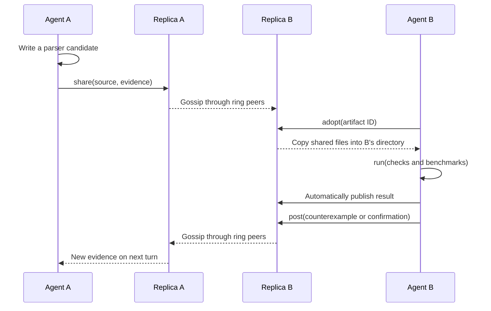
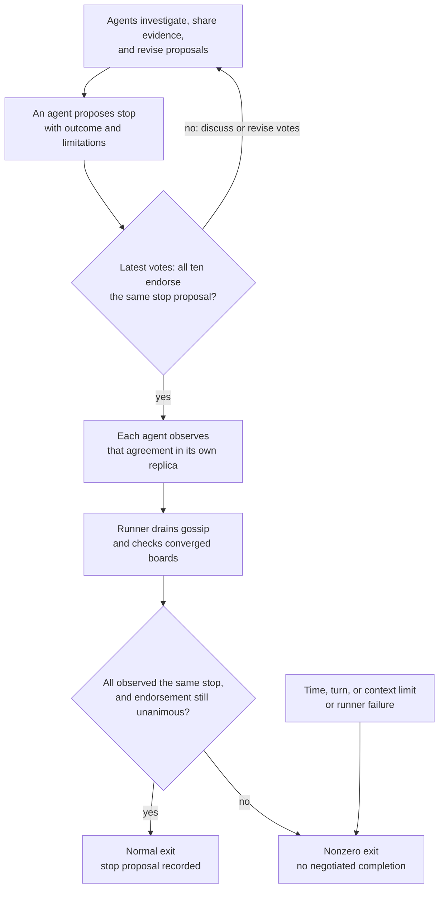

# How the research swarm collaborates

Ten `gpt-6-luna` agents receive the same goal. Each has a private conversation,
research directory, and Hearsay replica. Memory links connect replicas in a ring.
Agents choose their parsing contract, experiments, metrics, work, and stopping
criteria through proposals and votes. There is no central research planner.

## Source and evidence travel through replicas

This is one possible exchange. A and B have no assigned specialist roles.
Gossip arrows can span several ring links; intermediate peers are omitted.
`share` puts file contents in a message, and `adopt` copies them from the
receiving agent's local replica into its own directory.

All `run` commands use one shared execution lane, including builds, tests, and
benchmarks. Commands execute in the requesting agent's directory as the local
user. Agents can inspect results, revise candidates, and challenge claims;
this exchange does not prescribe a fixed research pipeline.

## Completion requires a shared stopping decision

A proposal alone does not stop the swarm. The latest vote from each of the ten
members must endorse the same `stop` proposal. Agents may change their votes;
each agent checks agreement using only its local replica.

The final check rejects differing or withdrawn stop decisions. A normal exit
confirms a cooperative agreement for the fixed membership; it does not prove
that the parser is optimal. A failed shell command is published evidence that
agents can investigate. Runner failures and operational ceilings interrupt the
run and produce a nonzero exit, even if useful research has already happened.

See the [example README](README.md) for running the swarm, its tools, and output files.
